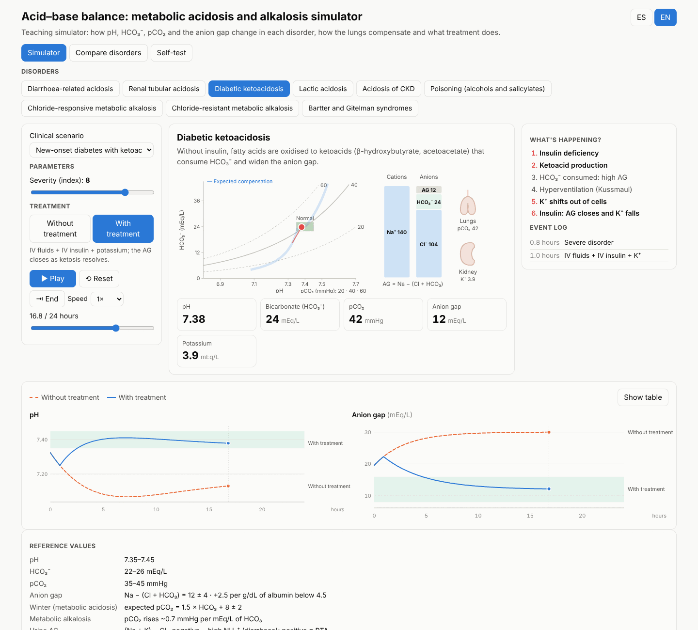

# Metabolic acid–base disorders

**Equilibrio ácido-base: acidosis y alcalosis metabólicas** — interactive teaching simulator (Spanish / English).

**Live demo:** https://ferasmed-dev.github.io/metabolic-acid-base/ · English: https://ferasmed-dev.github.io/metabolic-acid-base/?lang=en



A live pH–HCO₃⁻ (Davenport) diagram with pCO₂ isobars and the expected-compensation band, the patient's path across it, a gamblegram that shows the anion gap as a block, and lung / kidney indicators. Students pick a disorder, move its parameters and compare the course with and without treatment.

## What it shows

| Disorder | Group | Time axis | Treatment arm |
|---|---|---|---|
| Diarrhoea | normal-AG acidosis (urine AG −) | days | rehydration + alkali |
| Renal tubular acidosis I / II / IV | normal-AG acidosis (urine AG +) | days | alkali ± K⁺ / fludrocortisone |
| Diabetic ketoacidosis | high-AG acidosis | hours | fluids + insulin + K⁺ |
| Lactic acidosis | high-AG acidosis | hours | treat the cause; IV bicarbonate only if pH < 7.2 |
| Acidosis of CKD | AG mildly ↑ | months | oral bicarbonate (HCO₃⁻ ≥ 22) |
| Methanol, ethylene glycol, salicylates | high AG ± osmolar gap / respiratory alkalosis | hours | fomepizole + haemodialysis / urine alkalinisation |
| Chloride-responsive alkalosis (vomiting, diuretics) | urine Cl < 20 / > 20 | days | 0.9 % saline + KCl |
| Chloride-resistant alkalosis (hyperaldosteronism, Cushing, liquorice) | urine Cl > 20 + HTA | days | aldosterone antagonist / surgery / stop liquorice |
| Bartter and Gitelman | normotensive hypoK alkalosis | days | K⁺ and Mg²⁺ ± NSAID / aldosterone antagonist |

Every entity offers:

- a **schematic** that shows the mechanism live and highlights where the disorder acts;
- **sliders and choices** for the parameters that drive it;
- a **sin / con tratamiento** (without / with treatment) comparison drawn on the same chart (dashed = without, solid = with);
- a **"¿Qué está pasando?"** panel that lights up each step of the mechanism as it happens, plus an **event log**;
- gauges with reference ranges, a **data-table view** of every chart, a **compare** tab with all entities side by side and a **self-test** tab.

## Curriculum fit

For students and teachers at any Spanish medical faculty.

- **Module (Orden ECI/332/2008):** Módulo III, *Formación clínica humana* (with support from Módulo II for physiology and pathology).
- **Typical subjects:** Fisiología, Fisiopatología, Patología médica / Nefrología, Medicina intensiva y urgencias.
- **MIR:** high-yield every year (anion gap, urine anion gap, Winter, RTA types, chloride-responsive vs -resistant alkalosis).

## For teachers

Every scenario has a deep link you can project or share. Add `&lang=en` for English.

| Preset | Scenario (EN) | Expected result | Link |
|---|---|---|---|
| `colera` | Cholera-like diarrhoea | HCO₃ 23 → 9, pH 7.24 with normal AG and negative urine AG; treatment → pH 7.36 | [ES](https://ferasmed-dev.github.io/metabolic-acid-base/?preset=colera) · [EN](https://ferasmed-dev.github.io/metabolic-acid-base/?preset=colera&lang=en) |
| `atr_distal_sjogren` | Distal RTA in Sjögren syndrome | HCO₃ 15, K 3.0, urine pH > 5.5, nephrocalcinosis; alkali → HCO₃ 23, K 4.0 | [ES](https://ferasmed-dev.github.io/metabolic-acid-base/?preset=atr_distal_sjogren) · [EN](https://ferasmed-dev.github.io/metabolic-acid-base/?preset=atr_distal_sjogren&lang=en) |
| `atr_proximal_fanconi` | Proximal RTA with Fanconi syndrome | HCO₃ 17, K 3.2, urine pH < 5.5; alkali → 23 | [ES](https://ferasmed-dev.github.io/metabolic-acid-base/?preset=atr_proximal_fanconi) · [EN](https://ferasmed-dev.github.io/metabolic-acid-base/?preset=atr_proximal_fanconi&lang=en) |
| `atr_iv_diabetico` | Type IV RTA in a diabetic patient | HCO₃ 18, K 6.0; treatment → K 4.8 | [ES](https://ferasmed-dev.github.io/metabolic-acid-base/?preset=atr_iv_diabetico) · [EN](https://ferasmed-dev.github.io/metabolic-acid-base/?preset=atr_iv_diabetico&lang=en) |
| `cad_debut` | New-onset diabetes with ketoacidosis | AG 20 → 30, pH 7.16 untreated; insulin closes the AG to 12, pH 7.37 | [ES](https://ferasmed-dev.github.io/metabolic-acid-base/?preset=cad_debut) · [EN](https://ferasmed-dev.github.io/metabolic-acid-base/?preset=cad_debut&lang=en) |
| `shock_septico` | Septic shock treated early | Lactate 9 → 13 untreated vs 1.0 treated; no bicarbonate needed | [ES](https://ferasmed-dev.github.io/metabolic-acid-base/?preset=shock_septico) · [EN](https://ferasmed-dev.github.io/metabolic-acid-base/?preset=shock_septico&lang=en) |
| `shock_tardio` | Shock treated late | pH 7.26 → 6.92 untreated; treated at hour 6 with bicarbonate (pH < 7.2) → pH 7.38 | [ES](https://ferasmed-dev.github.io/metabolic-acid-base/?preset=shock_tardio) · [EN](https://ferasmed-dev.github.io/metabolic-acid-base/?preset=shock_tardio&lang=en) |
| `erc_avanzada` | Advanced CKD (GFR 12) | HCO₃ 22 → 14 over a year; oral bicarbonate keeps it at 23 | [ES](https://ferasmed-dev.github.io/metabolic-acid-base/?preset=erc_avanzada) · [EN](https://ferasmed-dev.github.io/metabolic-acid-base/?preset=erc_avanzada&lang=en) |
| `metanol` | Methanol poisoning | Osmolar gap 66 at once, AG > 18 from hour 1.5 (peak 29); fomepizole + HD keep AG at 12 | [ES](https://ferasmed-dev.github.io/metabolic-acid-base/?preset=metanol) · [EN](https://ferasmed-dev.github.io/metabolic-acid-base/?preset=metanol&lang=en) |
| `salicilatos` | Salicylate poisoning | AG 26 with pCO₂ below Winter (mixed disorder), no osmolar gap | [ES](https://ferasmed-dev.github.io/metabolic-acid-base/?preset=salicilatos) · [EN](https://ferasmed-dev.github.io/metabolic-acid-base/?preset=salicilatos&lang=en) |
| `vomitos_estenosis` | Vomiting from pyloric stenosis | HCO₃ 35, K 3.4, urine Cl < 20; saline + KCl → 25 | [ES](https://ferasmed-dev.github.io/metabolic-acid-base/?preset=vomitos_estenosis) · [EN](https://ferasmed-dev.github.io/metabolic-acid-base/?preset=vomitos_estenosis&lang=en) |
| `diureticos` | Diuretic-induced alkalosis | HCO₃ 32 with urine Cl > 20; saline + KCl → 25 | [ES](https://ferasmed-dev.github.io/metabolic-acid-base/?preset=diureticos) · [EN](https://ferasmed-dev.github.io/metabolic-acid-base/?preset=diureticos&lang=en) |
| `conn` | Conn syndrome | HCO₃ 32, K 2.9, SBP 165; aldosterone antagonist → SBP 130, HCO₃ 25 | [ES](https://ferasmed-dev.github.io/metabolic-acid-base/?preset=conn) · [EN](https://ferasmed-dev.github.io/metabolic-acid-base/?preset=conn&lang=en) |
| `regaliz` | Liquorice intake | Same picture as Conn; stopping liquorice reverses it | [ES](https://ferasmed-dev.github.io/metabolic-acid-base/?preset=regaliz) · [EN](https://ferasmed-dev.github.io/metabolic-acid-base/?preset=regaliz&lang=en) |
| `bartter_nino` | Child with Bartter syndrome | K 2.3, HCO₃ 32, normal BP; treatment → K 3.6 | [ES](https://ferasmed-dev.github.io/metabolic-acid-base/?preset=bartter_nino) · [EN](https://ferasmed-dev.github.io/metabolic-acid-base/?preset=bartter_nino&lang=en) |
| `gitelman_adulto` | Adult with Gitelman syndrome | K 2.8, Mg 1.1, HCO₃ 30; treatment → K 3.6 | [ES](https://ferasmed-dev.github.io/metabolic-acid-base/?preset=gitelman_adulto) · [EN](https://ferasmed-dev.github.io/metabolic-acid-base/?preset=gitelman_adulto&lang=en) |

You can also open a single entity with `?entity=<key>` (keys are listed in `src/model.js`).

## Model

- **pH** from Henderson–Hasselbalch: `pH = 6.1 + log10(HCO₃ / (0.03 · pCO₂))` (7.40 at 24 / 40).
- **Respiratory compensation:** expected pCO₂ = `1.5·HCO₃ + 8` (Winter) in acidosis and `40 + 0.7·(HCO₃ − 24)` in alkalosis; actual pCO₂ approaches it with a lag (0.5 days or 6 hours, Model). Salicylates add a primary respiratory alkalosis (pCO₂ 8 mmHg below Winter).
- **Anion gap** = Na − (Cl + HCO₃) with Na fixed at 140; normal-AG disorders raise Cl as HCO₃ falls, high-AG disorders add an unmeasured anion equal to the HCO₃ consumed (lactate, ketoacids, toxic acids). Albumin correction (+2.5 per g/dL below 4.5) is exported and tested.
- **Disorder drivers** (all Model): HCO₃ approaches a disorder-specific target with a time constant; treatment moves the target back to normal from a set time. Methanol/ethylene glycol are converted to acids at 18 %/h, so the osmolar gap peaks first and the AG second; fomepizole stops conversion.

**Model** tag: constants marked "Model" in `src/model.js` are teaching assumptions tuned so each preset reproduces the textbook course; they are not fitted to patient data.

### Parameters

| Parameter | Range (default) | Basis |
|---|---|---|
| Intestinal HCO₃ loss | 50–400 mEq/day (200) | Model |
| RTA type | I / II / IV | textbook types |
| Ketoacidosis / toxin dose / alkalosis intensity | 1–10 (7 / 6 / 6) | Model severity index |
| Initial lactate | 2–15 mmol/L (8) | > 2 lactic acidosis, > 5 severe |
| Hour the cause is treated | 0–8 h (1) | Model |
| GFR (CKD) | 5–40 mL/min (15) | acidosis common < 30 |
| Compensation | Winter ± 2; +0.7 mmHg per mEq/L in alkalosis | standard formulae |

### Known simplifications

- Na is fixed at 140 mEq/L and albumin at 4.5 g/dL in the live model, so the AG change mirrors the HCO₃ consumed (delta ratio ≈ 1).
- Only metabolic primary disorders (plus the salicylate respiratory component); primary respiratory disorders are out of scope.
- Stewart's physicochemical approach is not modelled.

### Content beyond the core notes

- The metabolic-alkalosis compensation (`+0.7 mmHg pCO₂ per mEq/L HCO₃`) is the standard formula; it is added because the notes give only Winter's formula.
- The anion gap is shown as 12 ± 4 mEq/L (the classic range); labs using ion-selective electrodes report lower normals (~8 ± 3).
- Bicarbonate in lactic acidosis only below pH 7.1–7.2 and the KDIGO target of HCO₃ ≥ 22 mEq/L in CKD come from current guidelines.

## Layout

```
index.html
src/model.js       pure model: entities, gauges, presets, simulate()
src/i18n.js        ES + EN strings (events are factories, so a language switch re-renders them)
src/ui.js          DOM, animation loop, explanations; exposes window.__sim for automated checks
src/schematic.js   SVG schematic of the mechanism, redrawn every frame
src/charts.js      dependency-free SVG line charts with hover tooltips and table view
src/styles.css     light/dark via prefers-color-scheme, responsive
tests/model.test.js
curriculum.json    topic metadata
```

## Run locally

```bash
python3 -m http.server 8000
# open http://localhost:8000/
```

No build step, no dependencies.

## Tests

```bash
npm test        # node --test (Node 18+)
```

The tests cover well-formed output for every entity at default and extreme parameters (finite, non-negative, valid steps), purity, i18n completeness in both languages, every preset, and the key mechanism of each entity (direction of each effect and the treatment comparison). GitHub Actions runs them on every push.

## Deploy (GitHub Pages)

Settings → Pages → *Deploy from a branch* → `main` / `(root)`. The site is served at https://ferasmed-dev.github.io/metabolic-acid-base/.

## References

- Berend K, de Vries APJ, Gans ROB. Physiological approach to assessment of acid–base disturbances. *N Engl J Med* 2014;371:1434–45.
- Kraut JA, Madias NE. Metabolic acidosis: pathophysiology, diagnosis and management. *Nat Rev Nephrol* 2010;6:274–85.
- Emmett M. Metabolic alkalosis: a brief pathophysiologic review. *Clin J Am Soc Nephrol* 2020;15:1848–56.
- KDIGO 2024 Clinical Practice Guideline for the Evaluation and Management of CKD. *Kidney Int* 2024;105(4S).
- Rose BD, Post TW. *Clinical Physiology of Acid-Base and Electrolyte Disorders*, 5th ed.

---

Herramienta docente · no apta para uso clínico — Teaching tool · not for clinical use. MIT licence © 2026 Feras Elhissi.
